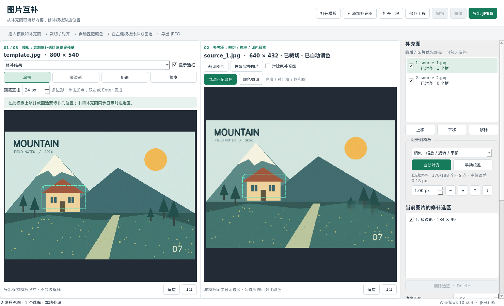

# 图片互补修补

用于 **Windows 10 64 位**的本地桌面工具。第一张图片作为模板，导入一张或多张补充图，在模板上涂抹或圈选要修补的位置，对齐并匹配颜色后使用补充图对应像素修补。适合同一原图的不同分辨率、不同裁切和不同遮挡版本。

默认导出 **JPEG，质量 95，不降低模板尺寸**；也可导出 PNG。处理过程中图片不上传网络。第一次通过源码启动或打包时需要联网安装依赖，便携版运行不需要 Python。

## Windows 使用

### 运行源码

1. 安装 **64 位 Python 3.12**（也支持 3.11 / 3.13）。安装时勾选 `Add Python to PATH`。
2. 将整个项目放到本地目录，双击 `start_windows.bat`。
3. 启动窗口会依次显示 Python 检测、环境准备、依赖检查、打开程序四个阶段。首次会创建项目专用的 `.venv` 并安装依赖；已有环境失效时会保留它，改用 `.venv-win`。
4. Qt 下载可能需要几分钟，安装过程中会显示进度；长时间没有新输出时会显示等待时长。

### 双击没有出现程序窗口

- **先完整解压压缩包**，不要在压缩包预览窗口中直接双击脚本。
- 使用更新后的 `start_windows.bat`，同时保留它旁边的 `bootstrap.py`；不要只替换一个文件。
- 启动脚本从第一行就显示标题。出错后窗口不会自动关闭，详情写到同目录的 **`startup.log`**；把日志最后约 30 行提供给开发者即可定位。
- 不需要反复重装依赖：新启动器会检查已安装版本，安装失败会明确停止，安装成功但导入失败也不会反复安装。
- 如果提示找不到 Python，安装 64 位 Python 3.12；Microsoft Store 的空占位别名不会被当作可用解释器。
- 如果提示目录不可写，请把整个项目解压到自己可写的本地目录再运行，例如桌面或文档目录。
- `build_windows.bat` 也使用相同的启动诊断流程，日志位置相同。

建议 Windows 10 1809 或更新版本，8 GB 及以上内存。Qt 版本固定为 6.9.3，避免依赖升级改变目标系统要求。参见 [Qt 6.9 支持的平台](https://doc.qt.io/archives/qt-6.9/supported-platforms.html)。

### 生成便携版

在 Windows 上双击 `build_windows.bat`。脚本会安装构建依赖；本地存在 `tests` 时运行测试，Git 仓库不含该目录时改做程序启动检查，再生成：

```text
dist/
  MosaicRepair/
    MosaicRepair.exe
    _internal/
    samples/
    third_party_licenses/
    README.md
```

将 **整个 `MosaicRepair` 文件夹**复制到其他 Windows 10 64 位电脑，双击其中的 `MosaicRepair.exe`。不要只复制 EXE，也不要将 `_internal` 文件夹删除。

也提供 `.github/workflows/build-windows.yml`，在 GitHub Actions 手动触发或推送 `v*` 标签可构建 Windows 便携包，构建前后分别执行源码和打包程序启动检查。`tests/` 按项目要求仅在本地保留，不上传 Git。

当前开发验证环境是 Linux；项目中的 Windows 打包脚本与 CI 配置尚需在 Windows 上实际执行。Linux 打包文件不能当作 Windows EXE。PyInstaller 使用方式见[官方文档](https://pyinstaller.org/en/stable/operating-mode.html)。

## 实际操作

第一次试用可点击“打开工程”，选择 `samples/demo.mrepair`。工程使用自制风景图，演示不同分辨率补充图、裁切、自由选区和自动调色，不包含用户照片。模板仅在房子处有马赛克，树木下方保持清晰，默认只选择房子进行修补。



界面从左到右依次为 **模板 / 修补预览 → 补充图裁切与颜色预览 → 补充图与选区管理**。

1. **导入图片**：把一张模板图拖入左侧，把一张或多张补充图拖入中间。也可使用顶部按钮。右侧列表选择当前补充图。
2. **裁切（可选）**：在中间点击“裁切图片”，拖出要保留的范围，点击“应用裁切”。可取消、撤销或恢复完整图片。
3. **对齐**：在右侧点击“自动对齐”；成功后左侧显示半透明叠加。特征不足时使用手动校准。
4. **自动匹配颜色**：新导入的补充图默认在对齐后自动分析重叠区域，匹配亮度、对比度、饱和度和偏色。中间显示调整后的完整补充图。也可点击中间“自动匹配颜色”重新计算。
5. **在左侧模板上选择修补范围**：默认“涂抹”，也可选多边形、矩形。完成后两张图同步显示带编号的对应轮廓，并更新结果。选区属于右侧当前选中的补充图。
6. **检查和调整**：模板可切换原图、修补结果、对齐叠加；勾选“对比原补充图”可对比调色前后。羽化以模板像素计，默认 3；小选区可减小到 0。
7. **导出 JPEG**：默认打开模板图片所在文件夹，文件名为“模板名_修补.jpg”，质量 95；仍可手动更换目录，也可选择 PNG，并使用 `.png` 扩展名。模板路径随工程保存；原目录不可用时，默认使用工程文件所在目录。导出不包含任何辅助线。
8. **保存工程**：`.mrepair` 内含原始图片、裁切、选区笔画、对齐与颜色参数；移动工程文件后仍能继续编辑。

裁切限制补充图可用的内容，**不会把整块裁切区域直接用于修补**。新选区使用模板坐标；补充图重新裁切或对齐不会移动模板上的选区。超出补充图或裁切范围的部分没有可供使用的像素，因此不会被填充。扩大裁切范围时，先点击“恢复完整图片”。

### 自由选区与涂抹

- **涂抹**：在左侧按住左键拖动，画笔直径按模板像素计算；每次松开鼠标保存为一个独立笔画。
- **多边形**：逐点单击勾出自由轮廓，双击或按 Enter 完成；完成前右键撤回一个顶点，Esc 取消。
- **矩形**：在左侧拖出矩形范围。
- **橡皮**：擦去当前补充图已经选择的范围，露出原模板或优先级较低的补充图。橡皮笔画也可单独删除、启停和撤销。
- 右侧选区列表按绘制顺序应用。默认合并同一补充图的选区，后画的橡皮会减去已选范围；之后仍可继续涂抹补回。
- “显示选框”控制两张图上的辅助轮廓，辅助线不会写进导出图片。

### 自动调色与手动微调

“自动匹配颜色”在对齐后的重叠区域内采样，排除当前补充图已选的修补范围、透明区域、过暗/过曝区域，并使用稳健统计降低马赛克等异常像素的影响。匹配得到整张补充图共用的明度对比、色度与偏色参数，因此可以在绘制第一个选区之前先匹配颜色。

- 中间的“颜色微调”按钮可跳转到右侧调色设置。
- 可调整自动匹配强度（0–100），以及亮度、对比度、饱和度、冷暖（-100–100）。手动微调叠加在自动匹配结果之上。
- “对比原补充图”只改变预览，不改变修补参数。“恢复原始颜色”关闭自动匹配并清空手动微调。
- 补充图预览、修补和导出使用同一套颜色参数。模板未被选中的区域保持原像素，JPEG 编码本身仍会有有损压缩。
- 匹配只能尽量减小色差，不能保证逐像素完全一致。重叠清晰区域不足或局部滤镜差异过大时，可减小匹配强度并手动微调；参考像素不足会明确提示。
- 旧版工程可直接打开，旧工程默认不自动调色，以保留原有外观；保存后升级为 v2 工程格式，旧版程序无法读取 v2 工程。


这张调色示例左侧显示“原始模板”，房子选区内保留马赛克；中间为清晰的补充图。将左侧下拉框切到“修补结果”可查看修补后的房子。

### 自动对齐不准时

- 用“对齐叠加”检查位置，不要只看“匹配成功”的文字。
- 少量平移误差可用侧栏方向按钮微调，默认每次移动模板上的 1 像素，可改为 0.1 像素。
- 自动匹配失败时，点击“手动校准”，先在补充图点一个清晰特征，再到左侧原模板点同一特征。
- 重复后点击“应用校准”。默认相似变换最少 2 对点；仿射最少 3 对且不能共线；透视最少 4 对，点应分散在图像各处。
- 手动校准会使用当前裁切范围内的全部有效点。更换校准方案时，可撤回一对点或清空点重选。位置差异较大时不要只选集中在一个小区域的点。

自动对齐参考 [OpenCV 特征匹配与变换文档](https://docs.opencv.org/4.x/d1/de0/tutorial_py_feature_homography.html)，使用 SIFT、双向匹配与 RANSAC，并拒绝特征不足或一致性差的结果。

### 多张补充图

- 右侧列表靠后的图片优先覆盖；用“上移 / 下移”调整顺序。
- 可取消勾选整张补充图，或只取消勾选某个选框。
- 当前补充图的选区有编号；在列表选中后按 `Delete` 或点击“删除选区”。选区不满意时删除重画。
- 所有编辑支持撤销 / 重做，保留最近 30 步；保存工程不保存撤销历史。
- 启用的选框若尚未对齐，导出会提示先对齐或取消勾选，避免漏补。

## 快捷键

| 操作 | 快捷键 |
|---|---|
| 打开模板 | Ctrl+O |
| 添加补充图 | Ctrl+I |
| 保存工程 | Ctrl+S |
| 导出结果 | Ctrl+E |
| 撤销 / 重做 | Ctrl+Z / Ctrl+Y |
| 删除当前选框 | Delete |
| 退出裁切 / 手动选点 | Esc |
| 缩放 | 鼠标滚轮 |
| 平移画布 | 鼠标中键拖动 |
| 适应窗口 / 原始像素大小 | 各画布底部的“适应”/“1:1” |

## 处理范围

- 使用补充图真实像素，不进行 AI 补画；如果所有图片的同一位置都被遮挡，没有可用的清晰内容可供补回。
- 低分辨率补充图的修补区域可能比模板模糊，羽化仅柔化接缝，不增加真实细节。
- JPEG 是有损格式，保存后全图像素可能因重新压缩而轻微变化。若需要保留未修补区域的精确像素，选择 PNG。
- 透明图片在处理与 PNG 导出时保留 Alpha；JPEG 导出将透明区域铺白。读取时应用 EXIF 方向，不保留原图的 EXIF/GPS 元数据或 ICC 色彩配置。
- 每张图最多 3600 万像素、单边最多 16000 像素；每个工程最多 99 张补充图、图片总计最多 1 亿像素；每张补充图最多 1000 个选区或笔画。实际容量还取决于内存。
- 导入支持 JPEG、PNG、WebP、BMP、TIFF 等 Pillow 可读取格式；多帧文件只读取第一帧。

## 开发验证

```bash
python -m pip install -r requirements-dev.txt
python -m pytest -q
python main.py
```

无桌面环境可设置 `QT_QPA_PLATFORM=offscreen`。测试包括自动缩放旋转与裁切配准、手动校准、多个选框和覆盖顺序、透明度、羽化边界、中文路径、EXIF 方向、工程往返保存，以及 Qt 实际鼠标框选、裁切、撤销和导出。

- `mosaic_repair/core.py`：图像配准、局部合成、读写图片。
- `mosaic_repair/colors.py`：全局色调估计、自动匹配和手动颜色调整。
- `mosaic_repair/selections.py`：自由选区、笔画、橡皮和模板 / 补充图坐标映射。
- `mosaic_repair/model.py`：工程状态、非破坏式裁切、便携工程格式。
- `mosaic_repair/widgets.py`：Qt 原图坐标画布、缩放、框选与点选。
- `mosaic_repair/app.py`：界面、后台任务、操作流程与历史。
- `PLAN.md`：已确认需求和设计。
